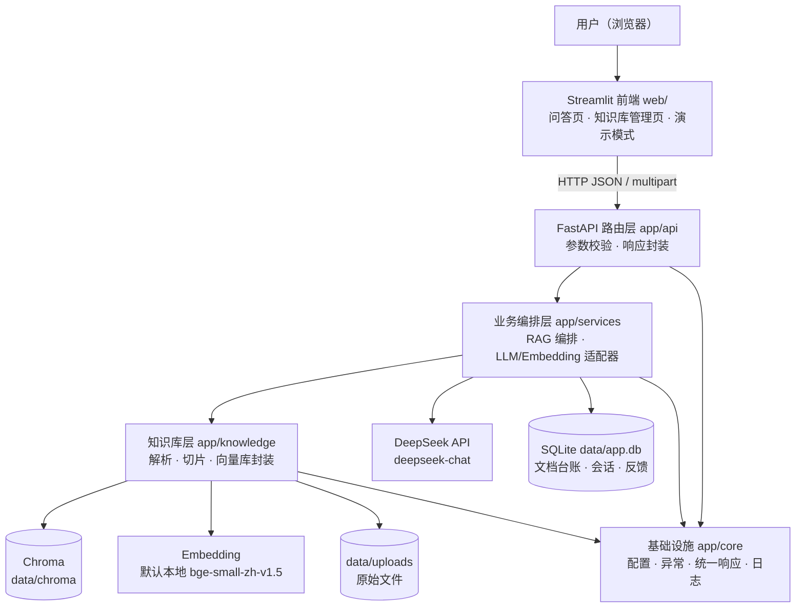
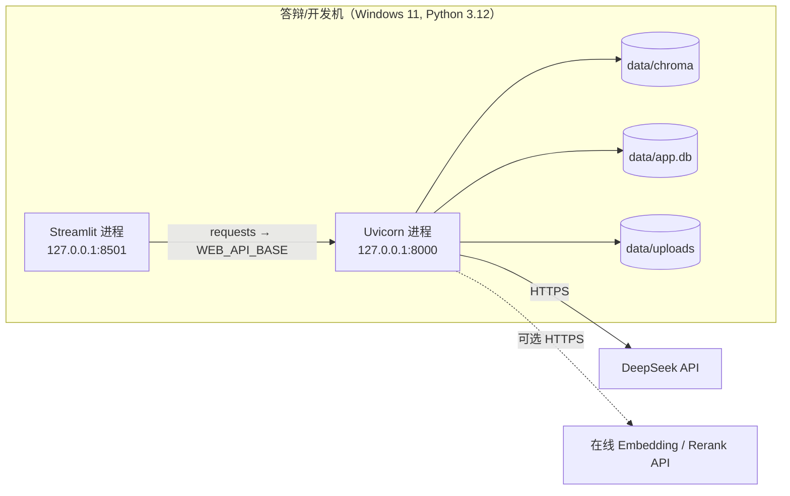
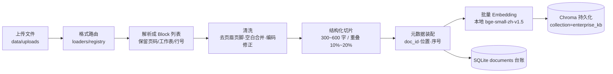
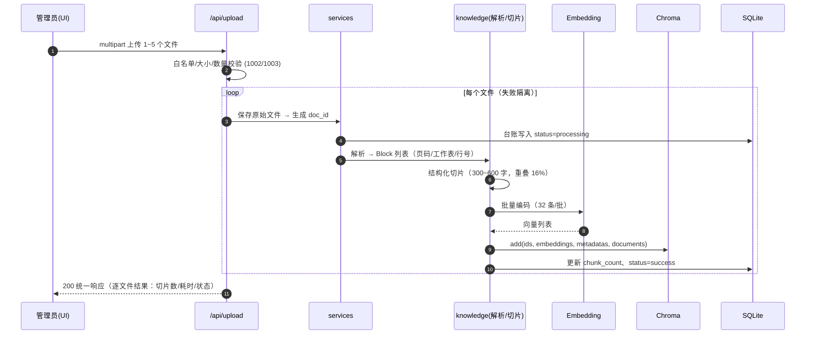
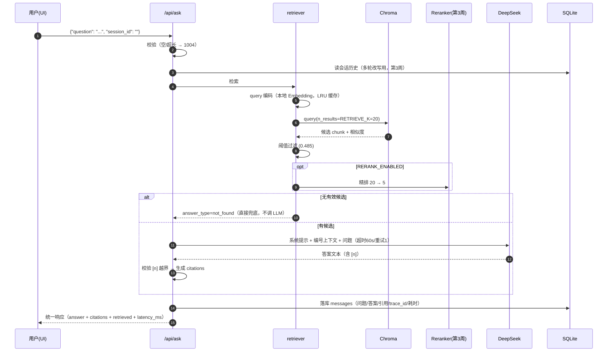

# 企业知识库智能问答系统 · 架构设计 v1

> 上游输入：[需求文档_v1.md](./需求文档_v1.md)　·　接口契约：[接口文档.md](./接口文档.md)　·　目录骨架：仓库已提交（模块职责见本文第 4 章）

| 项目信息 | 内容 |
| :--- | :--- |
| 项目名称 | 企业知识库智能问答系统（aiQAsystem） |
| 选题 | 选题4 · 企业知识库智能问答系统（⭐⭐⭐） |
| 团队 | 智231 小组 |
| 文档版本 | v1.0（第1周定稿版） |
| 文档状态 | 待评审（10-03 提交 · 10-04 周会评审） |
| 编写人（AD 架构设计师 + 知识库/向量库工程师） | 待组长填写姓名 / Gitee 账号 |
| 评审人 | PM 胡亦杨、RA、DEV、PE、UI |
| 关联任务 | W1-09 架构设计、W1-10 接口设计、W1-11 目录规范 |
| 关联需求 | `docs/需求文档_v1.md` 第 1.4 / 6 / 7 章 |
| 关联里程碑 | 第1周末 —— 架构与需求定稿 |
| 创建日期 | 2026-09-28 |

> **本文档的定位**：把需求翻译成"可施工的图纸"，回答四个问题：
> ① 系统由哪些部分组成、如何连接（第 3 章）；② 代码放在哪、谁负责（第 4 章）；
> ③ 知识库与向量库怎么建、检索怎么跑（第 6 章）；④ 为什么这么选（第 11 章 ADR）。
> 字段级接口契约见 `docs/接口文档.md`；两文档出现冲突时，以**接口文档**为准（契约优先）。

---

## 0. 一页纸总览

```text
                          ┌──────────────────────────────────┐
   用户（浏览器）          │  Streamlit 前端  web/             │
                          │  问答页 · 知识库管理页 · 演示模式   │
                          └───────────────┬──────────────────┘
                                          │ HTTP  (JSON / multipart / SSE)
                          ┌───────────────▼──────────────────┐
                          │  FastAPI 后端  app/               │
                          │  api/        路由与参数校验        │
                          │  services/   RAG 编排 · LLM 客户端 │
                          │  knowledge/  解析·切片·向量库      │
                          │  core/       配置·响应·异常·日志    │
                          └───┬───────────────────────┬──────┘
                              │                       │
              ┌───────────────▼────────┐   ┌──────────▼───────────────────┐
              │ Chroma 向量库           │   │ SQLite + 文件系统              │
              │ data/chroma             │   │ 文档台账 / 会话 / 反馈 / 原始文件 │
              └────────────────────────┘   └──────────────────────────────┘
                              │
                   ┌──────────▼───────────┐
                   │ DeepSeek API（生成）  │
                   │ Embedding（默认本地）  │
                   └──────────────────────┘
```

**给各角色的 5 条速览：**

1. **DEV**：后端分层**单向依赖** `api → services → knowledge / core`，禁止反向 import（3.2 节）；
2. **DEV/UI**：所有接口统一响应 `{"code","message","data"}`，错误码集中在 `app/core/errors.py`（第 5 章 + 接口文档）；
3. **DEV/PE**：检索是**两阶段**——向量召回 `RETRIEVE_K=20` →（第3周）Rerank → 取 `TOP_K=5`；阈值 `SCORE_THRESHOLD=0.485`（第2周实测校准，6.8 节）；
4. **AD/DEV**：每个 chunk 必须携带可溯源元数据 `doc_id / filename / page_no 或 sheet_name+row_range 或 line_range / chunk_index`（6.5 节）；
5. **全员**：可调参数一律放 `.env`，改配置不改代码（9.5 节，NFR-M-01）。

---

## 1. 设计目标与约束

### 1.1 架构必须服务的验收指标

| 指标（需求 1.4） | 目标值 | 架构对策 |
| :--- | :--- | :--- |
| M-01 检索命中率 Recall@5 | ≥ 80% | 结构化切片 + 中文 Embedding + 两阶段检索（召回 20 → 重排取 5） |
| M-02 引用准确率 | ≥ 85% | chunk 级元数据 + 编号上下文注入 + `citations` 结构化返回 |
| M-03 答案正确率 | ≥ 75% | 检索质量 + PE 的 Prompt 约束 + 兜底阈值（不硬答） |
| M-04 拒答正确率 | ≥ 90% | 相似度阈值 + `answer_type = answered / not_found / clarify` 三态 |
| M-05 响应时延 | 检索 P95 ≤ 1.5s；端到端 P95 ≤ 10s | Embedding 模型进程内单例常驻；向量库本地持久化；LLM 超时 60s + 重试 1 次 |
| M-06 文档解析成功率 | 100%（10 份样例） | 五格式独立解析器，单文件失败隔离，不中断服务 |
| M-07 首次可用时间 | ≤ 5 分钟 | 一键脚本 + Streamlit 单页操作 + 中文提示（不用术语） |
| M-08 稳定性 | 50 次提问不崩溃，错误率 < 2% | 全局异常处理器 + 外部调用超时/重试 + 日志与健康检查 |

### 1.2 约束条件

| 类型 | 约束 | 架构影响 |
| :--- | :--- | :--- |
| 周期 | 4 周，第2周才开发 RAG，第3周才引入 Rerank | 第1周必须冻结接口与目录，避免返工；Rerank 设计为可插拔开关 |
| 环境 | Windows 本地运行，Python 3.12+，单机演示 | 不引入 Docker / 中间件；向量库选嵌入式方案 |
| 网络 | 答辩现场可能断网 | Embedding 默认本地模型；提供演示模式（缓存问答） |
| 成本 | 学生项目，DeepSeek 按量付费 | 上下文 Token 预算 `MAX_CONTEXT_TOKENS=3000`；答案 ≤ 200 字 |
| 数据 | 课堂规模：≤ 200 份文档 / ≤ 20 万切片，单租户 | 单集合 + 元数据隔离即可，无需分库分片 |
| 合规 | 不得使用真实企业涉密材料，Key 不入库 | 样例数据虚拟企业；`.env` 由 `.gitignore` 排除 |

### 1.3 架构原则（优先级从高到低）

1. **可演示优先**：任何设计先保证"答辩现场 5 分钟内能跑通"，再谈优化；
2. **契约先行**：接口字段以 `docs/接口文档.md` 为唯一事实源，前后端并行开发；
3. **配置外置**：Top-K、阈值、模型名、切片长度全部进 `.env`（NFR-M-01）；
4. **失败隔离**：单个文档解析失败只影响该文件；LLM 故障降级提示，不泄露内部错误；
5. **可溯源**：引用是最高优先级功能（本项目核心亮点），元数据从解析阶段就开始保留；
6. **组件可替换**：LLM / Embedding / Rerank 全部走适配器接口，换供应商不改业务代码。

---

## 2. 技术选型

### 2.1 选型总表

| 层次 | 选型 | 版本 | 选型理由（一句话） | 备选与放弃原因 |
| :--- | :--- | :--- | :--- | :--- |
| Web 框架 | FastAPI | 0.115.x | 异步、自动生成 Swagger、Pydantic 校验一体化 | Flask（无异步/无校验）；Django（过重） |
| ASGI 服务器 | Uvicorn[standard] | 0.32.x | 与 FastAPI 配套，Windows 可用，`--reload` 开发友好 | Gunicorn（不支持 Windows） |
| 数据校验 | Pydantic v2 + pydantic-settings | 2.10.x / 2.7.x | 请求/响应模型 + `.env` 配置校验一套搞定 | 手写校验（易漏） |
| 大模型 | DeepSeek `deepseek-chat` | API | 课程统一指定、OpenAI 兼容、价格低、中文强 | 通义千问（备选，配置可切） |
| LLM 客户端 | `openai` SDK（指向 DeepSeek base_url） | 1.59.x | 官方兼容协议，重试/超时/流式开箱即用 | 自写 requests（重复造轮子） |
| Embedding（默认） | BAAI/bge-small-zh-v1.5（本地） | sentence-transformers 3.3.x | 中文效果好、512 维、CPU 可跑、**断网可用** | text2vec-base（效果弱）；仅云 API（断网即挂） |
| Embedding（可选） | 硅基流动 bge-m3 / 百炼 text-embedding-v3 | API | 不占内存、效果更好，切换只需改 `.env` | 默认不用：依赖网络与额度 |
| 向量库 | Chroma（PersistentClient） | 0.5.x | pip 即装、本地持久化、支持元数据过滤、单进程够用 | FAISS（无持久化/元数据检索弱）；Milvus（要 Docker，课堂过重） |
| Rerank（第3周） | BAAI/bge-reranker-base（本地 CrossEncoder） | sentence-transformers | 与 Embedding 同一套依赖，离线可用 | 云 Rerank API（备选，`.env` 可切） |
| 文本切分 | langchain-text-splitters | 0.3.x | `RecursiveCharacterTextSplitter` 中文分隔符切分成熟 | 纯手写切分（边界处理繁琐） |
| 文档解析 | pypdf / python-docx / openpyxl / chardet | 5.1 / 1.1 / 3.1 / 5.2 | 五种格式各用最稳的库，零外部依赖 | pdfplumber（慢）；OCR（超出 v1 范围） |
| 前端 | Streamlit | 1.41.x | Python 单语言、`st.chat_message` 原生聊天组件、1 天出原型 | Vue/React（UI 仅 1 人 4 周，成本过高） |
| 结构化存储 | SQLite（标准库 `sqlite3`） | 内置 | 零安装、单文件、文档台账/会话/反馈够用 | MySQL（要装服务）；不存（重启丢历史） |
| 日志 | 标准库 `logging` + 自定义格式 | 内置 | 零依赖，支持 `trace_id` 字段化输出 | loguru（多一个依赖，非必要） |
| 测试 | pytest + httpx/TestClient | 8.3.x | 接口与切片逻辑单测，供 RA 复验 | 手工点（不可复现） |

### 2.2 关键选型说明

**① 为什么向量库选 Chroma？**
本项目数据规模是"课堂级"（≤20 万切片），但要求**重启不丢数据**（FR-KB-02）和**按 `doc_id` 删除**（FR-KB-05）。Chroma 的 `PersistentClient` 一个参数解决持久化，`where={"doc_id": ...}` 解决过滤与删除；FAISS 需要自己维护 id→向量的映射文件，Milvus 需要 Docker，都会在 4 周周期内引入不必要的运维成本。

**② 为什么 Embedding 默认用本地模型？**
需求 NFR-C-04 明确要求"模型调用可离线降级（演示模式）"。本地 `bge-small-zh-v1.5`（约 100MB，512 维）在 CPU 上单条 query 编码约 10~30ms，满足检索 P95 ≤ 1.5s；同时不产生按量费用，方便 PE 反复评测。在线方案（bge-m3 / text-embedding-v3）保留为配置项，答辩机器内存紧张时可切换。

**③ LangChain 的定位：组件库，而不是框架。**
需求技术栈包含 LangChain。我们使用它成熟的 `langchain-text-splitters`（切分），并保留 `langchain-chroma` 作为可选适配；**RAG 主链路（召回 → 重排 → 拼接 → 生成 → 引用落库）自研**，理由是：引用溯源需要精确控制 chunk 元数据与编号上下文，框架的黑盒封装反而增加调试成本，也不利于答辩时讲清原理。

**④ 为什么单独用 SQLite 存业务数据？**
Chroma 只擅长存向量与切片元数据，不适合存"会话历史、反馈、文档台账"这类需要分页/更新的业务数据（FR-CONV-01、UC-08）。选标准库 `sqlite3` 而非 ORM：本项目只有 4 张表，`repository` 模式手写 SQL 即可，避免再引入一个依赖和维护成本。

**⑤ 为什么前端选 Streamlit？**
UI 只有 1 名成员、4 周周期，且需求是"内部工具"而非商业产品；Streamlit 的 `st.chat_message / st.chat_input / st.file_uploader / st.expander` 与需求中的"对话流、上传区、引用折叠、加载态"一一对应，1~2 天可出可用界面，把时间留给联调与演示打磨。

### 2.3 依赖与安装

- 依赖清单：仓库根目录 `requirements.txt`（已按"Web / LLM / RAG / 前端 / 测试"分组注释，版本锁定，满足 NFR-C-01）。
- 体积提示：`sentence-transformers` 会连带安装 CPU 版 PyTorch（下载约 200~300MB），整体安装时间 5~15 分钟；建议配置国内镜像：

```bash
pip install -r requirements.txt -i https://pypi.tuna.tsinghua.edu.cn/simple
```

- 环境变量模板：仓库根目录 `.env.example`（复制为 `.env` 后填写 Key，`.env` 已被 `.gitignore` 排除）。

---

## 3. 总体架构

### 3.1 分层架构图



文字版（Gitee 若不渲染 Mermaid 看这里）：

```text
浏览器 → [Streamlit web/] → HTTP → [FastAPI app/api] → [app/services] → [app/knowledge] → Chroma
                                                              │                └→ Embedding（本地/在线）
                                                              ├→ DeepSeek API（生成）
                                                              └→ SQLite（台账/会话/反馈）
所有层共享 app/core（配置/异常/统一响应/日志）
```

### 3.2 分层职责与依赖规则

| 层 | 目录 | 职责 | 允许依赖 | 禁止事项 |
| :--- | :--- | :--- | :--- | :--- |
| 路由层 | `app/api/` | 路由定义、参数校验、调用服务、返回 `ApiResponse` | `services`、`core`、`models` | 写业务逻辑、直接操作 Chroma/SQLite |
| 业务层 | `app/services/` | RAG 编排、LLM 调用、会话与反馈逻辑 | `knowledge`、`core`、`models` | 处理 HTTP 细节（Request/Response 对象） |
| 知识库层 | `app/knowledge/` | 文档解析、切片、向量化、向量库增删查 | `core` | 依赖 `services`/`api`（保持纯函数与可单测） |
| 基础设施 | `app/core/` | 配置、统一响应、错误码、异常处理器、日志 | 无（最底层） | 依赖上层任何模块 |
| 前端 | `web/` | 页面与交互，只通过 HTTP 调后端 | 后端 API（HTTP） | 直接 import 后端代码、读数据库 |

> **依赖方向铁律**：`api → services → knowledge → core`。任何反向 import 视为架构缺陷，评审时退回。
> 依据：NFR-M-02（核心链路可单测）、NFR-M-01（配置集中），以及"UI 换实现不影响后端"的解耦要求。

### 3.3 部署视图（单机）



| 进程 | 启动方式 | 端口 | 说明 |
| :--- | :--- | :--- | :--- |
| 后端 | `python -m uvicorn app.main:app --reload --port 8000` | 8000 | Swagger 文档：http://127.0.0.1:8000/docs |
| 前端 | `python -m streamlit run web/app.py` | 8501 | 通过环境变量 `WEB_API_BASE` 指向后端 |
| 一键启动 | `python scripts/run_all.py`（第2周 DEV 提供） | — | 便于答辩演示与 M-07 首次可用时间 |

> 单进程架构的容量结论：Uvicorn 单 worker + 向量库本地读取，支持 5 人并发提问（NFR-P-05）没有问题；
> 问答接口中 LLM 调用为 IO 等待，FastAPI 异步即可，无需多进程。

---

## 4. 模块划分与目录结构（W1-11 交付物）

### 4.1 目录树（仓库骨架已提交）

```text
aiQAsystem/
├─ app/                          # 后端（FastAPI）
│  ├─ main.py                    # 应用入口：create_app()、路由注册、异常处理器挂载
│  ├─ api/                       # 路由层：只做参数校验与响应封装
│  │  ├─ chat.py                 #   POST /api/chat            基础对话（第1周 DEV）
│  │  ├─ ask.py                  #   POST /api/ask             RAG 问答（第2周 DEV）
│  │  ├─ documents.py            #   /api/upload、/api/documents（第2周 DEV+AD）
│  │  ├─ conversation.py         #   会话与反馈接口（第3周 DEV）
│  │  └─ health.py               #   GET /api/health（第2周 DEV）
│  ├─ core/                      # 基础设施
│  │  ├─ config.py               #   .env → Settings（pydantic-settings）
│  │  ├─ response.py             #   ApiResponse：{"code","message","data"}
│  │  ├─ errors.py               #   错误码常量 + 业务异常 + 全局异常处理器
│  │  └─ logging.py              #   日志格式、trace_id 注入、Key 脱敏
│  ├─ models/                    # Pydantic 请求/响应模型（契约见 docs/接口文档.md）
│  ├─ services/                  # 业务编排
│  │  ├─ llm.py                  #   BaseLLM + DeepSeekClient（第1周 DEV）
│  │  ├─ embedding.py            #   EmbeddingProvider 适配器：local / 在线（第2周 AD）
│  │  ├─ reranker.py             #   Reranker 适配器（第3周 AD）
│  │  ├─ retrieval.py            #   召回→重排→阈值→上下文拼装（第2/3周 DEV+AD，W2-04 已交付）
│  │  ├─ rag.py                  #   RAG 主链路编排（第2周 DEV）
│  │  └─ repository.py           #   SQLite 访问层（documents/conversations/messages/feedback）
│  └─ knowledge/                 # 知识库（AD 主责）
│     ├─ loaders/                #   五格式解析器，统一输出 ParsedDocument
│     │  ├─ base.py              #     解析器接口 + ParsedDocument/Block 数据结构
│     │  ├─ pdf_loader.py / docx_loader.py / xlsx_loader.py / txt_loader.py / md_loader.py
│     │  └─ registry.py          #     扩展名 → 解析器 路由
│     ├─ splitter.py             #   结构化切片（含 Excel 表格转文本策略）
│     ├─ store.py                #   Chroma 封装：add / query / delete_by_doc / list / count
│     └─ metadata.py             #   doc_id 生成、元数据规范、引用位置格式化
├─ web/                          # 前端（Streamlit，UI 主责）
│  ├─ app.py                     #   问答页
│  ├─ pages/1_知识库管理.py       #   上传与文档列表
│  ├─ components/                #   引用卡片、状态提示等复用组件
│  └─ api_client.py              #   统一封装 requests 调用后端
├─ prompts/                      # PE 主责：Prompt 模板与说明文档
├─ scripts/                      # 运维脚本
│  ├─ init_kb.py                 #   批量导入 tests/sample_docs 建库（第2周 AD）
│  ├─ build_kb.py                #   重建向量库（第2周 AD）
│  ├─ eval_rag.py                #   跑 20 条评测集出 M-01~M-04（第2/3周 PE）
│  └─ run_all.py                 #   一键启动前后端（第2周 DEV）
├─ tests/                        # 测试与数据
│  ├─ sample_docs/               #   RA 已交付：10 份多格式示例文档 + 生成脚本
│  ├─ qa_dataset_v1.json         #   PE 交付：20 条评测集（第1周）
│  ├─ test_api_smoke.py          #   接口冒烟（第2周 DEV）
│  ├─ test_splitter.py           #   切片单测（第2周 AD）
│  └─ test_retriever.py          #   检索单测（第3周 DEV）
├─ data/                         # 运行时数据（不入库，仅保留 .gitkeep）
│  ├─ uploads/                   #   上传的原始文件
│  ├─ chroma/                    #   向量库持久化目录
│  └─ app.db                     #   SQLite（首次启动自动创建）
├─ docs/                         # 项目文档
│  └─ 周报/                       #   PM 会议纪要与周报
├─ requirements.txt              # 依赖锁定（第1周，AD）
├─ .env.example                  # 环境变量模板（第1周，AD）
├─ CONTRIBUTING.md / README.md
└─ day01/ … day05/               # DEV 课程代码（由 DEV 第1周内创建，与主工程解耦）
```

### 4.2 模块职责表

| 模块 | 主责角色 | 职责 | 交付周 | 对应需求 |
| :--- | :--- | :--- | :--- | :--- |
| `app/api/*` | DEV | 路由、参数校验、响应封装 | 第1~3周 | FR-OPS-01、UC-10/11 |
| `app/core/*` | DEV（AD 定规范） | 配置、错误码、统一响应、日志 | 第1周 | NFR-M-01、FR-OPS-01/03 |
| `app/models/*` | DEV（AD 定契约） | Pydantic 模型，与接口文档逐字段对齐 | 第1~3周 | US-15 |
| `app/services/llm.py` | DEV | LLM 基类 + DeepSeek 实现（超时/重试/脱敏） | 第1周 | UC-11、NFR-R-02 |
| `app/services/rag.py` | DEV | 检索→重排→生成→引用编排 | 第2周 | FR-QA-01、FR-CIT-01 |
| `app/services/retrieval.py` | AD + DEV | 召回、阈值过滤、上下文拼装 | 第2~3周（W2-04 已交付） | FR-QA-02/03/06 |
| `app/services/embedding.py` | AD | Embedding 适配器（本地/在线） | 第2周 | FR-KB-02 |
| `app/services/reranker.py` | AD | Rerank 适配器（可开关） | 第3周 | FR-QA-03 |
| `app/knowledge/loaders/*` | AD | 五种格式解析，统一 Block 结构 | 第2周 | FR-DOC-01/04、M-06 |
| `app/knowledge/splitter.py` | AD | 结构化切片 300~600 字、重叠 10%~20% | 第2周 | FR-KB-01/03 |
| `app/knowledge/store.py` | AD | Chroma 增删查、持久化、按文档删除 | 第2~3周 | FR-KB-02/04/05 |
| `app/knowledge/metadata.py` | AD | doc_id 规则、元数据与引用位置规范 | 第2周 | FR-CIT-02 |
| `web/*` | UI | 问答页、知识库管理页、引用展示、演示模式 | 第1~4周 | FR-UI-01~05 |
| `prompts/*` | PE | 系统提示词、RAG 提示词、引用格式约束 | 第1~3周 | FR-CIT-01、FR-QA-04 |
| `scripts/*` | AD/DEV/PE | 建库、重建、评测、一键启动 | 第2~3周 | M-06、M-01~04 |

### 4.3 编码约定（第1周冻结）

1. **分层单向依赖**：见 3.2 节；`knowledge` 内的代码不得 import `services`/`api`；
2. **配置读取**：任何模块不得出现 `os.getenv` 散落调用，统一 `from app.core.config import settings`；
3. **返回值**：路由层返回 `ApiResponse.ok(data)` / 抛 `BizError(code)`，禁止手写 `{"code": ...}` 字面量；
4. **命名**：模块/函数 `snake_case`，类 `PascalCase`，常量 `UPPER_SNAKE`；接口字段一律 `snake_case`（与接口文档一致）；
5. **doc_id 规则**：`doc_{上传日期}_{文件名短哈希}`，例如 `doc_20260928_3f9a1c`；`chunk_id = {doc_id}:{chunk_index}`；
6. **中文注释**：公共函数必须写中文 docstring（参数/返回/异常），便于答辩讲解与组内交接；
7. **禁止入库**：`.env`、`data/`、真实 API Key、生成物（`__pycache__`、`.venv`）一律在 `.gitignore` 中；
8. **提交信息**：遵循 `CONTRIBUTING.md`，格式 `feat|fix|docs|refactor|test|chore(<scope>): 说明`。

---

## 5. 接口设计总览（W1-10 交付物）

> 完整请求/响应示例、错误码、字段说明见 **[`docs/接口文档.md`](./接口文档.md)**；本节仅给全局视图。

### 5.1 接口清单

| 编号 | 方法与路径 | 用途 | 交付周 | 主责 | 关联需求 |
| :--- | :--- | :--- | :--- | :--- | :--- |
| API-01 | `GET /api/health` | 健康检查（服务/向量库/模型） | 第2周（第1周可选） | DEV | FR-OPS-02、NFR-O-02 |
| API-02 | `POST /api/chat` | 基础对话（打通 DeepSeek） | **第1周** | DEV | UC-11、FR-OPS-01 |
| API-03 | `POST /api/upload` | 上传文档并构建知识库 | 第2周 | DEV + AD | FR-DOC-01~04、UC-01 |
| API-04 | `GET /api/documents` | 知识库文档列表 | 第2周 | DEV + AD | FR-KB-04、US-11 |
| API-05 | `DELETE /api/documents/{doc_id}` | 删除文档及其向量 | 第3周 | AD + DEV | FR-KB-05、US-10 |
| API-06 | `POST /api/ask` | RAG 问答（答案 + 引用） | 第2周 | DEV | FR-QA-01~07、FR-CIT-01~04、UC-10 |
| API-07 | `POST /api/ask`（`stream=true`） | SSE 流式问答（可选） | 第3周 | DEV | FR-UI-03 |
| API-08 | `POST /api/feedback` | 答案点赞/点踩 | 第3周 | DEV | UC-08、US-12 |
| API-09 | `GET /api/conversations` | 会话列表 | 第3周 | DEV | FR-CONV-01、US-13 |
| API-10 | `GET /api/conversations/{session_id}` | 会话详情（含引用） | 第3周 | DEV | FR-CONV-01/02 |
| API-11 | `DELETE /api/conversations/{session_id}` | 清空/删除会话 | 第3周 | DEV | FR-CONV-02 |

### 5.2 全局约定摘要

- **统一响应**：`{"code": 0, "message": "success", "data": {...}}`；分页 `data = {"total", "page", "page_size", "items"}`；
- **错误码分段**：`1xxx` 请求/校验，`2xxx` 知识库，`3xxx` 模型与外部服务，`5xxx` 服务端内部；
- **HTTP 状态码**：与业务 `code` 并存（HTTP 表达传输语义，`code` 表达业务语义），详见接口文档 1.3；
- **trace_id**：`/api/ask` 与 `/api/chat` 响应必须带 `trace_id`，串联日志（FR-OPS-04）；
- **时间格式**：ISO 8601 带时区，如 `2026-10-01T10:20:30+08:00`。

### 5.3 Pydantic 模型与接口文档的对应

`app/models/` 下的模型类名与接口文档字段一一对应，命名示例：
`ChatRequest / ChatResponse`、`AskRequest / AskResponse / Citation / RetrievedChunk`、
`UploadResult / DocumentItem / DocumentListData`、`FeedbackRequest / ConversationData`。
DEV 实现时**先抄接口文档的字段表**，再写代码，禁止先写代码后补文档（契约先行）。

---

## 6. 知识库与向量库设计（AD 核心章节）

> 本章是第2周 `app/knowledge/` 模块的施工图，也是第3周检索优化的基线。

### 6.1 数据处理总流程



设计要点：
1. **解析与切片分离**：`loaders` 只负责"文件 → Block 列表"，不关心长度；`splitter` 只负责"Block → chunk"，便于各自单测；
2. **位置信息在解析阶段产生**，切片阶段只做继承与合并，绝不在切片后反查原文（保证 FR-CIT-02 引用可溯源）；
3. **先落盘、再入库**：原始文件先写入 `data/uploads/{doc_id}/`，解析失败时台账记录 `status=failed`，可重试，不影响其他文档（NFR-R-01）。

### 6.2 统一数据结构（`app/knowledge/loaders/base.py`）

```python
class Block:
    text: str                 # 文本内容
    page_no: int | None       # PDF/Word：页码（1 起）
    sheet_name: str | None    # Excel：工作表名
    row_start: int | None     # Excel/TXT：起始行号
    row_end: int | None       # Excel/TXT：结束行号
    section: str | None       # Word/Markdown：所属标题路径，如 "3.2 报销标准"
    block_type: str           # text | table | heading | list

class ParsedDocument:
    filename: str             # 原文件名
    file_type: str            # pdf|docx|xlsx|txt|md
    blocks: list[Block]
    warnings: list[str]       # 如"检测到扫描版 PDF，无文本层"（对应 FR-DOC-04 提示）
```

> 约定：**Block 列表是有序的**，且每个 Block 的位置元数据必须完整；若某格式无法提供页码，则退化为 `row_start/row_end` 或章节名，保证"总能定位"。

### 6.3 五种格式的解析要点（对应 FR-DOC-01、需求 7.1）

| 格式 | 解析库 | 关键处理 | 引用定位单位 | 已知坑与对策 |
| :--- | :--- | :--- | :--- | :--- |
| PDF `.pdf` | pypdf | 逐页 `extract_text()`；页眉页脚启发式去除（同页首尾 ≤ 2 行且跨页重复 ≥ 60% 时剔除） | 页码 | 扫描件无文本层 → `warnings` 记录并返回"该 PDF 可能是扫描件，暂不支持 OCR"；中文乱码 → 尝试 `layout` 模式兜底 |
| Word `.docx` | python-docx | 按段落顺序读取；`Heading N` 样式维护标题路径；表格逐行转文本 | 页码（若无分页符则退化到章节标题） | 老版 `.doc` → 提示"请另存为 .docx"；合并单元格 → 内容重复填充并标注 |
| Excel `.xlsx` | openpyxl | 逐工作表；首行识别为表头；数据行转 `列名: 值` 文本；`data_only=True` 读缓存值 | 工作表名 + 行号范围 | 公式未计算 → 单元格为空时跳过并记录 warning；数值格式化保留原样（如 5.5 天、¥300） |
| 文本 `.txt` | 标准库 + chardet | 自动识别 UTF-8/GBK；按段落（空行）聚合 | 行号范围 | 编码识别置信度 < 0.7 → 依次尝试 utf-8 / gbk / utf-8-sig；全失败则报"编码无法识别" |
| Markdown `.md` | 标准库 | 按 `#` 标题层级切片；保留列表与代码块完整性 | 章节标题（+行号） | 标题层级跳跃（H1→H3）时按当前最近标题处理 |

### 6.4 切片策略（对应 FR-KB-01/03）

**目标**：切片长度 300~600 字、重叠 10%~20%（即 `CHUNK_SIZE=500`，`CHUNK_OVERLAP=80`），且**不破坏语义边界**。

```text
算法：结构优先 + 长度兜底
1) 结构边界优先：一个 Block（段落/表格行组/章节段）天然就是一个候选切片；
2) 合并：顺序累加 Block，直到长度 ≥ CHUNK_SIZE（500 字）后停止；
3) 超长：单个 Block > 600 字时，用 RecursiveCharacterTextSplitter
   （分隔符优先级：段落 \n\n → 换行 \n → 中文句号 。！？； → 逗号 → 空格 → 硬切）
   按 CHUNK_SIZE 切开，相邻块保留 CHUNK_OVERLAP 重叠；
4) 过短：单块 < 80 字时优先与相邻块合并，避免"半句话"入库；
5) 表格特殊处理：Excel 每个切片重复表头，最多 EXCEL_ROWS_PER_CHUNK=20 行；
6) 清洗：过滤纯页眉页脚、纯数字页码、空白字符超过 60% 的块。
```

**参数（`.env` 可调）**：`CHUNK_SIZE=500`、`CHUNK_OVERLAP=80`（16%）、`MIN_CHUNK_CHARS=80`、`EXCEL_ROWS_PER_CHUNK=20`。

**验收口径**（RA 抽查 10 个 chunk）：无一句话被从中间断开、无跨章节串味、元数据与原文位置一致。

### 6.5 元数据 Schema（引用溯源的关键）

每个 chunk 写入 Chroma 时携带以下 metadata（Chroma 仅支持 `str/int/float/bool`）：

| 字段 | 类型 | 示例 | 用途 |
| :--- | :--- | :--- | :--- |
| `doc_id` | str | `doc_20260928_3f9a1c` | 删除/过滤/台账关联（FR-KB-05） |
| `filename` | str | `01_员工手册.pdf` | 引用显示"来源文件名"（FR-CIT-01） |
| `file_type` | str | `pdf` | 列表统计与图标 |
| `chunk_index` | int | `12` | chunk 在文档内序号，`chunk_id = doc_id:12` |
| `page_no` | int | `3` | 引用位置：`第 3 页`（FR-CIT-02） |
| `sheet_name` | str | `差旅标准` | 引用位置：`工作表「差旅标准」`（ADR-07） |
| `row_start` / `row_end` | int | `5` / `24` | 引用位置：`第 5~24 行` |
| `section` | str | `3.2 报销标准` | Markdown/Word 章节引用 |
| `char_count` | int | `486` | 质量抽查（切片长度分布） |
| `embedding_model` | str | `bge-small-zh-v1.5` | 换模型时识别需重建的数据 |
| `created_at` | str | `2026-10-05T14:00:00+08:00` | 入库时间 |

**引用位置格式化规则**（`app/knowledge/metadata.py::format_location`，DEV 直接调用）：

| 优先级 | 条件 | 输出示例 |
| :--- | :--- | :--- |
| 1 | `sheet_name` 存在 | `工作表「差旅标准」第 12~31 行` |
| 2 | `page_no` 存在 | `第 3 页` |
| 3 | `section` 存在 | `章节「3.2 报销标准」` |
| 4 | `row_start` 存在 | `第 15~22 行` |
| 5 | 兜底 | `第 N 段` |

### 6.6 Chroma 集合设计

| 项 | 取值 | 说明 |
| :--- | :--- | :--- |
| 客户端 | `chromadb.PersistentClient(path=CHROMA_DIR)` | 服务重启不丢数据（FR-KB-02、NFR-R-03） |
| 集合名 | `enterprise_kb`（`CHROMA_COLLECTION` 可改） | 单租户单集合（v1 范围界定 1.5） |
| 相似度 | `hnsw:space = "cosine"` | 与归一化后的 bge 向量匹配；相似度 = 1 - 余弦距离 |
| 写入 ID | `f"{doc_id}:{chunk_index}"` | 全局唯一，且天然支持幂等覆盖 |
| 批量写入 | 每批 ≤ 100 条（`add` 分批） | 避免单次请求过大 |
| 查询 | `query(query_embeddings=[q], n_results=retrieve_k, where={...})` | 召回阶段 |
| 删除 | `delete(where={"doc_id": doc_id})` | 按文档级联删除（FR-KB-05） |
| 统计 | `count()` + SQLite 台账 | 健康检查与列表页数据 |
| 重建 | `delete_collection` + 重新导入 `data/uploads` | `scripts/build_kb.py` |

> **一致性策略**：以 SQLite `documents` 台账为"账本"，Chroma 为"索引"。写入顺序 = 先切片入库成功 → 再更新台账 `status=success`；删除顺序 = 先删向量 → 再删台账，任一步失败记录日志并允许脚本重建。

### 6.7 Embedding 设计（`app/services/embedding.py`）

```python
class EmbeddingProvider(Protocol):
    model_name: str
    dim: int
    def embed_documents(self, texts: list[str]) -> list[list[float]]: ...
    def embed_query(self, text: str) -> list[float]: ...
```

| 实现 | 触发条件 | 模型 | 维度 | 说明 |
| :--- | :--- | :--- | :--- | :--- |
| `LocalEmbeddingProvider`（默认） | `EMBEDDING_PROVIDER=local` | `BAAI/bge-small-zh-v1.5` | 512 | 进程内单例懒加载（首次约 5~10s），CPU 约 10~30ms/条 query；**断网可用** |
| `SiliconFlowEmbeddingProvider` | `EMBEDDING_PROVIDER=siliconflow` | `BAAI/bge-m3` | 1024 | 需 `SILICONFLOW_API_KEY`；批量 ≤ 32 条/次 |
| `DashscopeEmbeddingProvider` | `EMBEDDING_PROVIDER=dashscope` | `text-embedding-v3` | 1024 | 需 `DASHSCOPE_API_KEY` |

工程约束：
1. **维度一致性校验**：写入前对比 `provider.dim` 与集合实际维度，不一致直接报错提示"请执行 `scripts/build_kb.py` 重建"（防止查不出结果的隐性 bug）；
2. **归一化**：本地模型输出做 L2 归一化后再入库（cosine 空间更稳定）；
3. **批处理**：入库按 `EMBEDDING_BATCH_SIZE=32` 分批，带进度日志；
4. **缓存**：进程内 LRU（≥ 512 条）缓存 query 向量，重复提问省一次编码；
5. **bge 前缀约定**：查询侧加 `为这个句子生成表示以用于检索相关文章：`（bge 官方推荐），**文档侧不加**——封装在 provider 内部，调用方无感。

### 6.8 检索与重排设计（`app/services/retriever.py`）

**两阶段检索**（第2周先跑通第一阶段，第3周启用 Rerank）：

```text
用户问题（可含多轮上下文）
   │  ① （第3周）多轮改写：把"那转正后呢？"结合历史补全为完整问题
   ▼
[召回] Chroma query，RETRIEVE_K = 20 条（扩大召回，给重排留余地）
   │  ② 相似度过滤：score < SCORE_THRESHOLD(0.485) 直接丢弃
   ▼
[重排]（第3周，RERANK_ENABLED=true）bge-reranker-base 对 20 条精排
   │  ③ 取 TOP_K = 5 作为上下文
   ▼
[拼装] 编号上下文（[1]~[5]）→ 注入 Prompt → DeepSeek 生成
```

| 参数 | 默认值 | 位置 | 调优记录 |
| :--- | :--- | :--- | :--- |
| `RETRIEVE_K` | 20 | `.env` | 第3周对比 10/20/30 取 M-01 最优 |
| `TOP_K` | 5 | `.env` | 需求 FR-QA-02 默认 5 |
| `SCORE_THRESHOLD` | 0.485 | `.env` | **ADR-08**：2026-10-08 用 20 条评测集实测校准（越界最高 0.479 / 正确来源最低 0.490），第3周复核 |
| `MAX_CONTEXT_TOKENS` | 3000 | `.env` | 约 5 个 500 字 chunk 的安全上限（控制成本与时延） |
| `RERANK_ENABLED` | false | `.env` | 第3周默认改为 true，并输出对比数据 |

**上下文拼装格式**（Prompt 模板由 PE 维护，此处只定数据结构）：

```text
[1] 来源：01_员工手册.pdf（第 3 页）
入职满 1 年不满 10 年的员工，每年享有 5 天年假……
[2] 来源：08_考勤与假期管理规定.txt（第 12~18 行）
……
```

**关键约束**：编号 `[n]` 由程序生成而非模型自由发挥；模型只允许引用注入的编号，生成后由程序校验答案中的 `[n]` 是否越界（越界则剔除并记日志）——这是 M-02 引用准确率的工程保障。

### 6.9 生成与引用返回

- Prompt：`prompts/` 下维护（PE 主责），程序负责注入 `context`、`question`、`history`；
- **回答规范**（与需求 8.3 一致）：中文、要点式、≤ 200 字、每个结论后附 `[n]` 上标；
- **`citations` 结构**：程序依据模型实际引用的 `[n]`，从命中的 chunk 元数据生成 `Citation{index, doc_id, source_file, location, snippet, score, chunk_id}`，**不依赖模型输出**（防伪造来源）；
- 若模型未使用任何编号但返回了实质答案 → 视为"无依据回答"，降级为 `not_found` 并记日志（宁可不答，不可编造）。

### 6.10 兜底与澄清（FR-QA-04、M-04）

| 触发条件 | `answer_type` | 返回内容 |
| :--- | :--- | :--- |
| 召回条数为 0，或全部低于阈值 | `not_found` | "未在知识库中找到相关依据"，并建议补充文档/联系管理员；`citations=[]` |
| 召回结果命中多个互斥标准（如不同城市住宿标准），且问题未限定 | `clarify` | 列出适用条件并请用户补充关键信息（US-09） |
| 正常命中 | `answered` | 基于上下文的答案 + `citations` |

**调参原则**（第3周与 PE 共同执行）：在评测集上画"阈值 vs 拒答率/召回率"曲线，选择 M-04 ≥ 90% 前提下 M-01 最高的阈值点，结果写入质量报告。

### 6.11 文档删除与重建（FR-KB-05、US-10）

```text
DELETE /api/documents/{doc_id}
  1) 校验 doc_id 存在（SQLite 台账），不存在 → code=1005（HTTP 404）
  2) store.delete(where={"doc_id": doc_id}) → 返回 deleted_chunks
  3) 删除 data/uploads/{doc_id}/ 下原始文件
  4) 更新台账 status="deleted"（保留记录便于审计）或物理删除，二选一由 DEV 实现
  5) 返回 {"doc_id": ..., "deleted_chunks": N}
重建：python scripts/build_kb.py --rebuild   # 清空集合 → 扫描 data/uploads → 全量重导入
```

### 6.12 面向 PE 评测的接口与日志支持（M-01~M-04）

`/api/ask` 响应中必须返回 `retrieved`（Top-5 的 `chunk_id / score / rerank_score / source_file / location`）与 `trace_id`；
日志中记录 `trace_id / question / retrieved_chunk_ids / answer_type / model / latency_ms`（NFR-O-01）。
→ PE 的 `scripts/eval_rag.py` 据此直接统计 Recall@5（`expected_source` 是否在 `retrieved` 中）与引用准确率，无需额外埋点。

---

## 7. 数据存储设计

### 7.1 存储划分

| 存储 | 位置 | 存什么 | 谁写入 | 备份/重建 |
| :--- | :--- | :--- | :--- | :--- |
| Chroma | `data/chroma/` | 向量 + chunk 元数据 | `knowledge/store.py` | 用 `data/uploads/` 全量重建 |
| SQLite | `data/app.db` | 文档台账、会话、消息、反馈 | `services/repository.py` | 删除即重置（演示环境可接受） |
| 文件系统 | `data/uploads/{doc_id}/原始文件名` | 上传原始文件 | `api/documents.py` | 手工备份目录即可 |
| 内存 | 进程内 | Embedding 模型、Rerank 模型、query 向量缓存 | `services/*` | 重启即重建（无状态设计） |

### 7.2 SQLite 表结构（v1）

```sql
-- 文档台账（配合 Chroma，作为"账本"）
CREATE TABLE IF NOT EXISTS documents (
    doc_id        TEXT PRIMARY KEY,
    filename      TEXT NOT NULL,
    file_type     TEXT NOT NULL,          -- pdf|docx|xlsx|txt|md
    size_bytes    INTEGER NOT NULL,
    upload_time   TEXT NOT NULL,          -- ISO8601
    chunk_count   INTEGER DEFAULT 0,
    status        TEXT NOT NULL DEFAULT 'processing'  -- processing|success|failed|deleted
);

-- 会话（FR-CONV-01/02）
CREATE TABLE IF NOT EXISTS conversations (
    session_id    TEXT PRIMARY KEY,
    title         TEXT,                   -- 默认取首个问题前 20 字
    created_at    TEXT NOT NULL,
    updated_at    TEXT NOT NULL
);

-- 消息（问答明细，含引用 JSON，便于回看）
CREATE TABLE IF NOT EXISTS messages (
    message_id    TEXT PRIMARY KEY,
    session_id    TEXT NOT NULL REFERENCES conversations(session_id),
    role          TEXT NOT NULL,          -- user|assistant
    content       TEXT NOT NULL,
    citations     TEXT,                   -- JSON 数组（assistant 消息）
    trace_id      TEXT,
    latency_ms    INTEGER,
    created_at    TEXT NOT NULL
);

-- 反馈（UC-08、US-12）
CREATE TABLE IF NOT EXISTS feedback (
    feedback_id   TEXT PRIMARY KEY,
    message_id    TEXT NOT NULL,
    session_id    TEXT NOT NULL,
    rating        TEXT NOT NULL,          -- up|down
    comment       TEXT,
    created_at    TEXT NOT NULL
);

CREATE INDEX IF NOT EXISTS idx_messages_session ON messages(session_id, created_at);
CREATE INDEX IF NOT EXISTS idx_feedback_session ON feedback(session_id);
```

字段与需求 7.4 数据字典一致；`message_id` 规则 `msg_{yyyymmdd}_{6位随机}`，`session_id` 规则 `conv_{yyyymmdd}_{6位随机}`。

---

## 8. 关键流程时序

### 8.1 上传建库链路（UC-01）



### 8.2 问答链路（UC-03/UC-04）



### 8.3 失败与降级路径

| 故障 | 系统行为 | 面向前端的提示（中文、无堆栈） | 对应需求 |
| :--- | :--- | :--- | :--- |
| 未配置 API Key | 捕获 → `code=3003` | "服务未配置模型密钥，请联系管理员" | FR-SEC-04 |
| LLM 超时/限流 | 重试 1 次 → 仍失败 `code=3001/3002` | "回答生成超时，请稍后重试" | NFR-R-02 |
| 向量库只读/损坏 | 日志 + `code=2003` | "知识库暂时不可用，请稍后重试" | NFR-R-01 |
| 单文件解析失败 | 该文件 `status=failed`，其余文件继续 | "《xxx.pdf》解析失败：文件可能已损坏" | FR-DOC-04 |
| 知识库为空 | 不调用 LLM → `code=2001` | "请先上传文档建立知识库" | FR-UI 空态 |
| 断网（答辩现场） | 前端切换演示模式，读取预置问答 | 正常展示预置答案（标注"演示数据"） | FR-UI-05、S7 |

---

## 9. 非功能性架构设计

### 9.1 性能预算（对齐 M-05：检索 P95 ≤ 1.5s，端到端 P95 ≤ 10s）

| 环节 | 预算 | 保障手段 |
| :--- | :--- | :--- |
| 问题校验 + 会话读取 | ≤ 50ms | SQLite 本地读 + 索引 |
| query 编码 | ≤ 100ms | 本地小模型 + LRU 缓存 + 进程内单例 |
| Chroma 召回 20 条 | ≤ 300ms | 本地持久化 + HNSW 索引 + 数据量受控 |
| Rerank 20 条（第3周） | ≤ 800ms | CrossEncoder CPU（20 条约 200~500ms）；超预算则降到 10 条 |
| 上下文拼装 | ≤ 20ms | 纯字符串操作 |
| LLM 生成（≤200 字） | ≤ 8s，P95 | DeepSeek 流式/非流式；超时 60s；上下文 ≤ 3000 tokens |
| **合计（不含 LLM）** | **≤ 1.5s** | 满足 M-05 检索段指标 |

### 9.2 并发与资源

- Uvicorn 单进程 + async 路由；Embedding/Rerank 模型为**进程内单例**，首次加载加锁（避免并发重复加载）；
- CPU 密集的编码/重排放入线程池（`run_in_threadpool`），避免阻塞事件循环；
- 目标：5 人同时提问不劣化（NFR-P-05）；课堂演示环境足够；
- 内存预算：bge-small（~200MB）+ reranker-base（~1.1GB，第3周可选开启）→ 建议演示机内存 ≥ 8GB。

### 9.3 安全设计（NFR-S-01~04）

| 风险 | 对策 |
| :--- | :--- |
| API Key 泄露 | 只存 `.env`（已 gitignore）；日志统一脱敏为 `sk-****`；响应体不返回 Key |
| 路径穿越 | 上传文件名 sanitize（去 `../`、控制字符），服务端重命名为 `{doc_id}/{date}_{safe_name}` |
| 恶意文件 | 扩展名白名单 `{pdf,docx,xlsx,txt,md}` + MIME 复核 + ≤20MB + 单次 ≤5 个 |
| 内部信息泄露 | 全局异常处理器统一返回业务错误码；禁止把 Traceback、绝对路径写进响应 |
| 越权访问 | v1 单租户无鉴权（范围界定）；演示环境可选口令（FR-SEC-05，第4周） |

### 9.4 可观测性

- **trace_id**：每次问答/上传生成 `trace_id`（`tr_{yyyymmdd}_{6位}`），贯穿 API → 检索 → 生成 → 落库；
- **日志字段**（`app/core/logging.py` 统一格式）：
  `time | level | trace_id | module | event | 关键参数`；
  事件示例：`retrieval.done top_k=5 scores=[0.72,0.68,...]`、`llm.call model=deepseek-chat latency_ms=4200 tokens=1650`；
- **健康检查**：`GET /api/health` 返回 `llm / embedding / vector_store / sqlite` 四项状态（NFR-O-02）；
- 日志文件：`data/logs/app.log`（滚动 10MB × 5），同时在控制台输出。

### 9.5 配置管理（`.env` 全量清单，NFR-M-01）

| 分组 | 变量 | 默认值 | 说明 |
| :--- | :--- | :--- | :--- |
| LLM | `LLM_PROVIDER / DEEPSEEK_API_KEY / DEEPSEEK_BASE_URL / LLM_MODEL` | deepseek / sk-xxx / api.deepseek.com / deepseek-chat | 模型接入 |
| LLM | `LLM_TIMEOUT_SECONDS / LLM_MAX_RETRIES / LLM_TEMPERATURE / LLM_MAX_TOKENS` | 60 / 1 / 0.3 / 1024 | 稳定性与输出控制 |
| Embedding | `EMBEDDING_PROVIDER / EMBEDDING_MODEL / EMBEDDING_DIM / EMBEDDING_BATCH_SIZE / EMBEDDING_DEVICE` | local / BAAI/bge-small-zh-v1.5 / 512 / 32 / cpu | 向量化 |
| Rerank | `RERANK_ENABLED / RERANK_PROVIDER / RERANK_MODEL` | false / local / BAAI/bge-reranker-base | 第3周启用 |
| 检索 | `RETRIEVE_K / TOP_K / SCORE_THRESHOLD / MAX_CONTEXT_TOKENS / ANSWER_MAX_CHARS` | 20 / 5 / 0.485 / 3000 / 200 | 检索与生成 |
| 切片 | `CHUNK_SIZE / CHUNK_OVERLAP / MIN_CHUNK_CHARS / EXCEL_ROWS_PER_CHUNK` | 500 / 80 / 80 / 20 | 知识库构建 |
| 存储 | `CHROMA_DIR / CHROMA_COLLECTION / UPLOAD_DIR / SQLITE_PATH` | ./data/... | 持久化路径 |
| 限制 | `MAX_FILE_SIZE_MB / MAX_FILES_PER_UPLOAD` | 20 / 5 | 上传限制 |
| 服务 | `API_HOST / API_PORT / WEB_API_BASE / LOG_LEVEL / DEMO_MODE` | 127.0.0.1 / 8000 / http://127.0.0.1:8000 / INFO / false | 启动与前端联调 |

> 完整模板见仓库根目录 `.env.example`；`app/core/config.py` 用 pydantic-settings 加载并做类型/范围校验，缺失必填项时**启动即报错并给出中文提示**（而不是运行到一半才崩）。

---

## 10. 部署与运行

### 10.1 环境要求

| 项 | 要求 | 检查方式 |
| :--- | :--- | :--- |
| Python | 3.12+（3.11 亦兼容，但以 3.12 为准） | `python --version` |
| 内存 | ≥ 8GB（第3周开启 Rerank 时） | 任务管理器 |
| 磁盘 | ≥ 3GB（PyTorch + 模型缓存） | — |
| 网络 | 仅 LLM 调用必需；Embedding/Rerank 可离线 | — |

### 10.2 启动步骤（Windows）

```bash
# 1) 环境
python -m venv .venv
.venv\Scripts\activate
pip install -r requirements.txt -i https://pypi.tuna.tsinghua.edu.cn/simple

# 2) 配置
copy .env.example .env      # 填入 DEEPSEEK_API_KEY

# 3) 启动后端（Swagger: http://127.0.0.1:8000/docs）
python -m uvicorn app.main:app --reload --port 8000

# 4) 启动前端（http://127.0.0.1:8501）
python -m streamlit run web/app.py

# 5) （第2周起）导入示例文档建库
python scripts/init_kb.py
```

### 10.3 首次运行自动初始化

`app/main.py` 启动时执行（幂等）：
1. 创建 `data/uploads`、`data/chroma`、`data/logs` 目录；
2. 初始化 SQLite 表（执行 7.2 节 DDL）；
3. 校验 Chroma 集合与 Embedding 维度是否一致（不一致给出重建提示）；
4. 打印启动横幅：版本、模型、集合名、切片数（便于答辩时一眼确认状态）。

---

## 11. 关键决策记录（ADR）

| 编号 | 决策 | 理由 | 备选 | 影响 | 状态 |
| :--- | :--- | :--- | :--- | :--- | :--- |
| ADR-01 | 向量库用 Chroma PersistentClient，单集合 | pip 即装、持久化与元数据过滤开箱即用、课堂规模足够 | FAISS / Milvus | 换库需改 `store.py` 一个文件（已隔离） | ✅ 已定 |
| ADR-02 | Embedding 默认本地 bge-small-zh-v1.5，可切在线 | 离线可演示（NFR-C-04）、无费用、中文好 | 仅云 API | 换模型必须重建向量库（维度校验会拦住） | ✅ 已定 |
| ADR-03 | LangChain 只作组件库（splitter），主链路自研 | 引用溯源需精确控制元数据与编号，自研便于调试与答辩讲解 | 全量 LangChain 链 | `knowledge/splitter.py` 使用 `langchain-text-splitters` | ✅ 已定 |
| ADR-04 | 业务数据用 SQLite（标准库 sqlite3，手写 SQL） | 4 张表规模小，零依赖，便于备份与排障 | MySQL / ORM | `repository.py` 提供 DAO；不引入迁移框架 | ✅ 已定 |
| ADR-05 | 两阶段检索：召回 20 → 重排 5，第3周启用 Rerank | 兼顾 M-01 命中率与 M-05 时延；Rerank 开关化便于做 A/B 对比 | 单阶段检索 | 第3周需输出对比数据（FR-QA-03） | ✅ 已定 |
| ADR-06 | 引用由程序依据 chunk 元数据生成，模型只输出 `[n]` 编号 | 防止模型伪造来源，保障 M-02 引用准确率 | 让模型直接输出文件名/页码 | 生成后需做 `[n]` 越界校验 | ✅ 已定 |
| ADR-07 | **Excel 引用定位粒度 = 工作表名 + 行号范围**（回应需求 Q-04） | 单元格级定位对模型与前端都是负担，行号足以人工核对 | 精确到单元格 `C5` | chunk 元数据保留 `row_start/row_end`；表格切片重复表头 | ✅ 已定（10-03 前闭环） |
| ADR-08 | **相似度阈值 0.485**（回应需求 Q-02）：2026-10-08 以 20 条评测集实测，越界问题最高 0.479、正确来源最低 0.490，取窗口中间值（初版 0.35 会放行全部越界问题，已废弃） | 用数据定阈值；M-04 需 5/5 拒答成功 → 阈值必须 > 0.479；M-01 需保住正确来源 → 阈值 ≤ 0.490 | 0.35（误、偏松）；0.5（会丢 QA-019 的 0.490 命中） | 阈值写入 `.env`；第3周引入 Rerank 后复核 | ✅ 已定（第3周复核） |

---

## 12. 架构风险与对策

| 风险 | 等级 | 触发信号 | 对策 | 责任 |
| :--- | :--- | :--- | :--- | :--- |
| 本地 Embedding 首次加载慢（5~10s），答辩首问超时 | 中 | 冷启动首问 > 10s | 启动时预热（后台线程加载模型）；README 提示"提前 1 分钟启动" | AD |
| 切片质量差导致召回不准 | 高 | M-01 < 80% | 按 6.4 结构调整；PE 用评测集定位是"切片问题"还是"Prompt 问题" | AD + PE |
| 向量库与台账不一致（删了文档还能检索到） | 中 | 列表与检索结果不符 | 删除按 6.11 顺序执行；提供 `scripts/build_kb.py --rebuild` 兜底 | AD |
| 阈值过高误拒答 / 过低乱答 | 高 | M-04 < 90% 或 M-03 下滑 | 第3周阈值曲线调优；`not_found` 文案给出补救建议 | AD + PE |
| 中文字体/编码问题导致解析乱码 | 中 | 解析文本出现 `?`/乱码 | chardet 多编码尝试 + 单测覆盖 GBK 样例 | AD |
| DeepSeek 限流导致演示卡顿 | 中 | 429 错误 | 重试 + 演示模式预置问答（断网可用） | DEV + UI |

---

## 13. 第2周 AD 任务预告（提前对齐）

| 任务 | 交付物 | 验收标准 | 截止 |
| :--- | :--- | :--- | :--- |
| 文档解析模块 | `app/knowledge/loaders/`（5 个解析器 + registry） | `tests/sample_docs/` 10 份全部解析成功（M-06=100%），Block 元数据完整 | 10-09 |
| 切片模块 | `app/knowledge/splitter.py` + `tests/test_splitter.py` | 抽查 10 个 chunk 无断句错误；长度 300~600 字 | 10-09 |
| 向量库模块 | `app/knowledge/store.py` + `scripts/build_kb.py` | 重启服务后仍可检索；按 doc_id 删除生效 | 10-09 |
| Embedding 适配 | `app/services/embedding.py` | 本地/在线两种 provider 可通过 `.env` 切换 | 10-09 |
| 建库验证 | `scripts/init_kb.py` 运行记录（截图/日志） | 10 份文档入库切片总数与分布记录在案 | 10-10 |

---

## 14. 变更记录

| 版本 | 日期 | 修订人 | 变更内容 | 评审状态 |
| :--- | :--- | :--- | :--- | :--- |
| v1.0 | 2026-09-28 | AD | 首版：技术选型、分层架构、目录结构、接口总览、知识库/向量库设计、存储 DDL、时序、NFR、ADR（含 Q-02/Q-04 闭环） | 待 10-04 周会评审 |
| v1.1 | —— | —— | （预留：第2周依据解析/切片实测数据修订） | —— |
| v1.2 | —— | —— | （预留：第3周依据 Rerank 与阈值调优结果修订） | —— |
